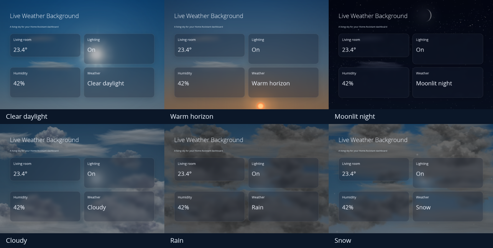
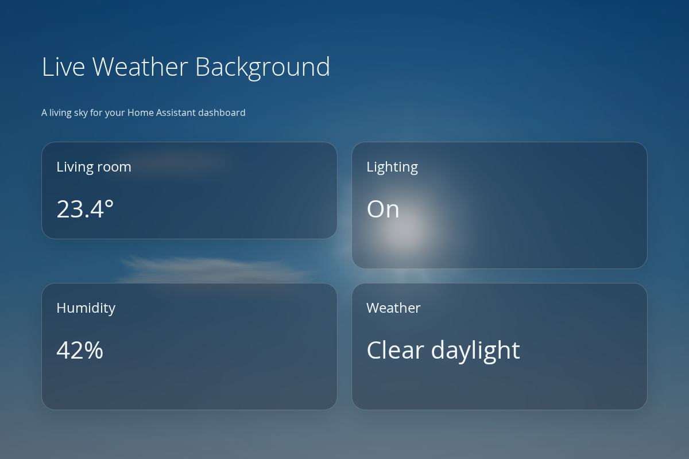
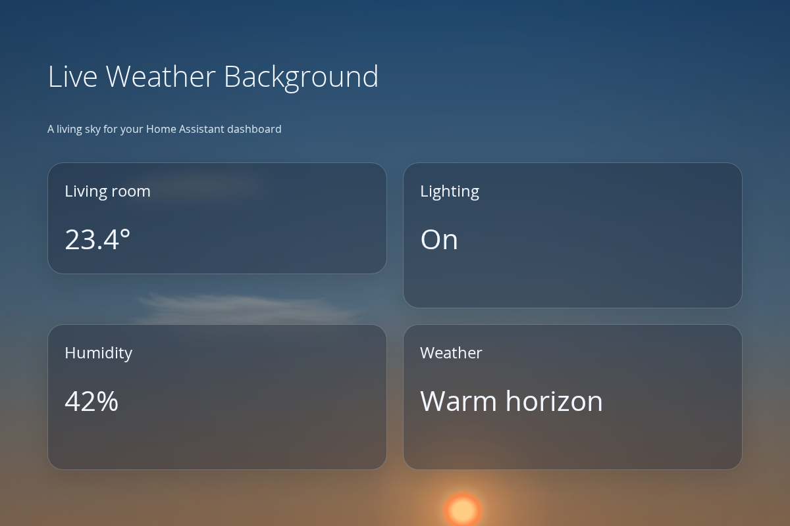
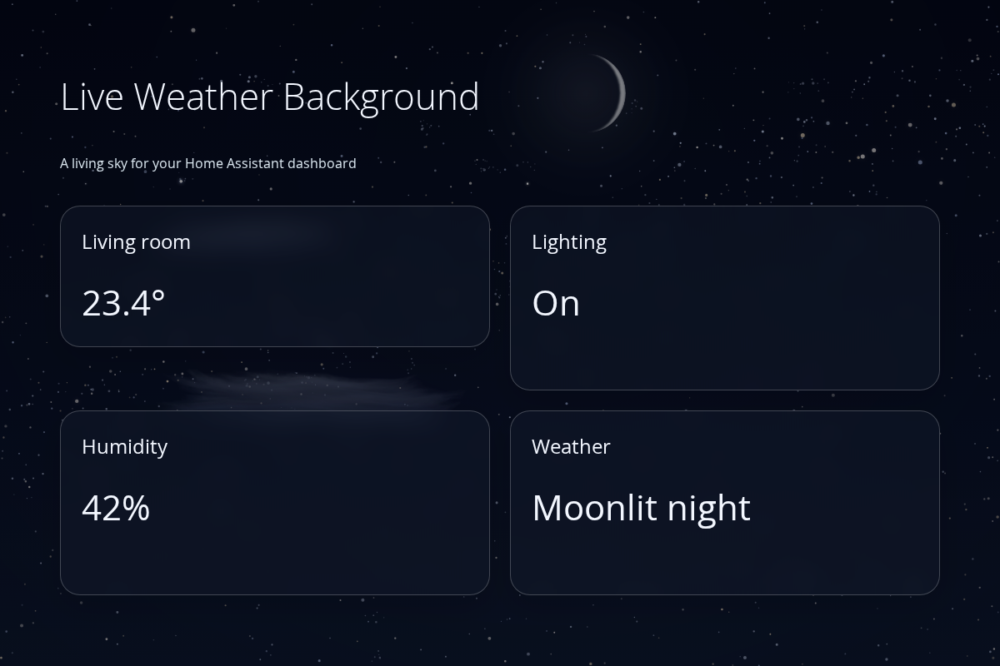
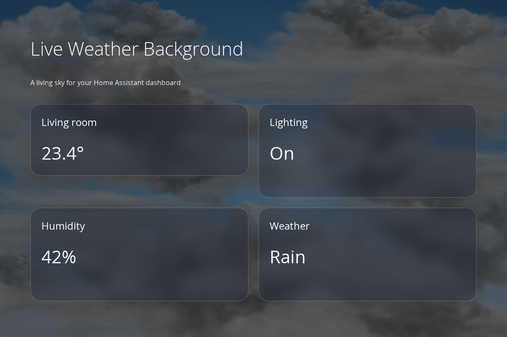
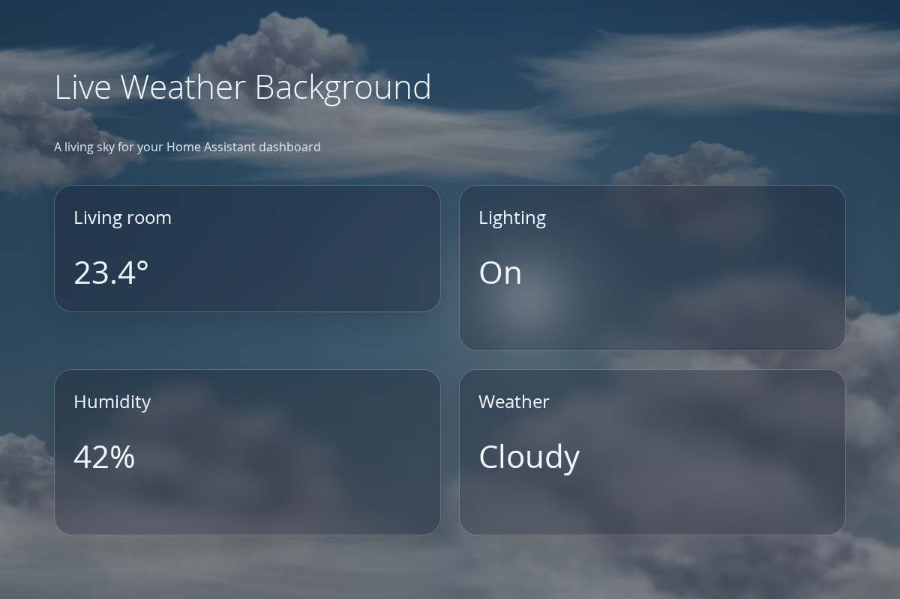
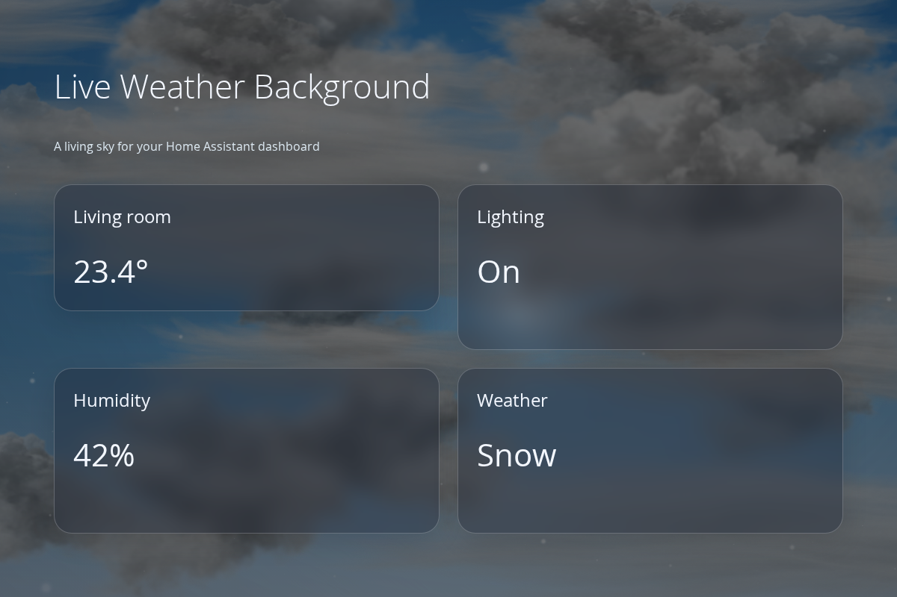

# Live Weather Background

**A living sky for your entire Home Assistant dashboard.** Clear blue days, warm horizons, slow twilight, moonlight and weather that moves across the screen.

[Русский](README.ru.md) · [Configuration](docs/configuration.md) · [Changelog](CHANGELOG.md) · [License](LICENSE)



[Watch the day/night demo](docs/day-night.mp4)

## Inspiration and thanks

**[Origami Weather](https://github.com/hazymorning/origami_weather), created by [hazymorning](https://github.com/hazymorning), is what inspired us to build this project.** Its beautiful animated sky made us want that atmosphere across the whole Home Assistant dashboard.

This project uses Origami Weather's rendering engine and graphical resources, with our own fullscreen adapter, daylight/twilight transitions, solar lighting, lunar edge smoothing and storm-cloud enhancements. Full attribution, the exact upstream source and our modifications are documented in [THIRD_PARTY_NOTICES.md](THIRD_PARTY_NOTICES.md). The combined project is open source under **GPL-3.0-only** and available without charge.

## What it does

- A fullscreen, view-scoped background, controlled by your own weather and sun entities.
- Continuous sky colors from solar elevation: blue daytime, golden horizon, blue hour and night. No sudden night palette at sunset.
- A bright solar core, atmospheric halo and soft unequal rays. Rays weaken at sunrise/sunset and under cloud cover.
- A textured Moon with a softened phase boundary, stars, meteors, birds, balloons and aircraft.
- Original textured clouds and fog, with denser grey banks for rain, snow, sleet, hail and thunderstorms. Lightning illuminates the banks.
- A preview that runs a full 24-hour day for **each** weather condition; 30 seconds per day by default.
- No external images, video files, CDN requests or separate Origami Weather installation at runtime.

<details>
<summary>More previews</summary>

| Clear daylight | Warm horizon |
| --- | --- |
|  |  |

| Moonlit night | Rain clouds |
| --- | --- |
|  |  |

| White clouds | Snow clouds |
| --- | --- |
|  |  |

Screenshots use synthetic entities in the project's demo fixture. They do not show a real home's entities or personal data.

</details>

## Install

### HACS Marketplace — custom repository

This repository is prepared for installation as a **custom repository**. It is **not yet included in the default Marketplace catalog**.

1. In HACS, open **Custom repositories**.
2. Add `https://github.com/lavalex2003/lovelace-live-weather-background`, category **Dashboard** (older HACS versions may call it **Lovelace**).
3. Download **Live Weather Background** and reload the browser.
4. Check that this JavaScript module exists under dashboard **Resources**:

   ```text
   /hacsfiles/lovelace-live-weather-background/live-weather-background.js
   ```

HACS normally registers the resource automatically. If your resources are managed in YAML, add the module there yourself. Register it once, not together with an older manual copy.

### Manual installation

1. Download `live-weather-background.js` from the release assets, or from [`dist/`](dist/live-weather-background.js).
2. Copy it to `/config/www/live-weather-background.js`.
3. Add `/local/live-weather-background.js?v=2.4.0` as a **JavaScript module** in dashboard Resources.
4. Reload the browser. This one file includes the engine and image assets.

For YAML-managed resources:

```yaml
resources:
  - url: /local/live-weather-background.js?v=2.4.0
    type: module
```

Place `resources` in the Lovelace resource configuration appropriate to your installation; it is not a card or a view setting.

## Add it to a view

Add this helper card to the view you want to decorate. Replace `weather.home` with your own weather entity. Keep `sun.sun`, or select your sun entity.

```yaml
type: custom:dashboard-weather-background
weather_entity: weather.home
sun_entity: sun.sun
```

The registered card type remains `dashboard-weather-background`; the downloadable file is named `live-weather-background.js`. Configure it with the YAML editor. The helper is intentionally invisible and returns a card size of zero. It paints only its owning view and does not intercept clicks.

See the complete [Masonry view example](examples/masonry.yaml). For a layout-card dashboard, put the helper into the existing view's `cards` list; do not replace your whole dashboard. Only one background helper should be used per view.

The adapter has been exercised on a YAML dashboard using `custom:grid-layout` and on isolated desktop/mobile browser fixtures, including popup stacking. It depends on Home Assistant's frontend view structure, so additional layouts and future frontend versions need compatibility testing. There is no visual configuration editor yet.

## Preview a full day for every weather condition

```yaml
type: custom:dashboard-weather-background
weather_entity: weather.home
sun_entity: sun.sun
preview: true
preview_interval: 30
```

Each condition runs from 06:00 through noon, sunset and midnight to the next dawn. Both lights move. The label shows the virtual clock and countdown. The full 15-condition loop takes **7 minutes 30 seconds**. Use `preview_interval: 60` for a slower presentation. Set `preview: false` to return to your actual entities.

Preview values stay inside the renderer: it does not alter HA entities, call services or change any other cards. The night variant of clear weather is normalized to the current simulated daylight; the two clear-weather entries therefore both demonstrate a full day.

## Configuration and performance

All options and limits are listed in [docs/configuration.md](docs/configuration.md). The defaults use 24 fps and a 100 px light-source container. Cloud tinting is separate from precipitation so snowflakes keep their color.

Animation pauses when the view/tab is hidden or the system requests reduced motion. Each of three canvas layers is capped at approximately 1.2 million pixels. On slower tablets, try `fps: 15` and disable decorative actors. A detailed real-time preview still updates its simulated clock; turn preview off for normal use.

The lunar phase is approximate, and the Moon follows a stylized night arc, **not a lunar ephemeris**. This is a decorative background rather than an astronomical instrument.

## Develop

No npm dependencies or bundler installation are needed. Use Node.js 22+ and Python 3:

```sh
npm run build
npm test
```

`src/` holds the adapter and extracted engine; `vendor/origami_weather/` preserves the matching upstream source and license. `scripts/vendor_origami.py` verifies the engine extraction. `scripts/build.mjs` creates the self-contained distribution without minification. The browser fixture imports that distribution, not an alternate implementation.

For the browser smoke test, start Chromium with remote debugging on port 9223 and local file access enabled, then run `node tests/verify_browser.cjs`. This requires Node.js 22+ with its built-in WebSocket client. See [development notes](docs/development.md).

## License

[GPL-3.0-only](LICENSE). Original work and artwork remain credited to their authors; see [third-party notices](THIRD_PARTY_NOTICES.md). Free to use, study, modify and redistribute under that license. No warranty. This project is not affiliated with or endorsed by Origami Weather, Home Assistant or Apple.

Preview captions use Russian for a Russian HA locale and English otherwise.
