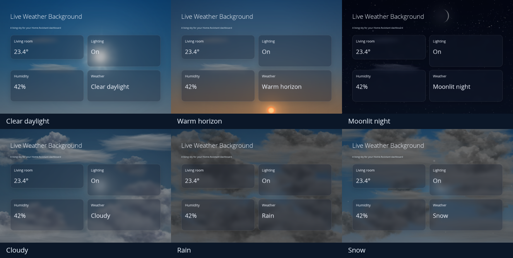

# Live Weather Background

**Живое небо на всём дашборде Home Assistant.** Голубой день, тёплый горизонт, плавные сумерки, лунный свет и движущаяся погода.

[English](README.md) · [Все настройки](docs/configuration.md) · [История изменений](CHANGELOG.md) · [Лицензия](LICENSE)



[Посмотреть короткий суточный цикл](docs/day-night.mp4)

## Что нас вдохновило и кому мы благодарны

**Именно карточка [Origami Weather](https://github.com/hazymorning/origami_weather) автора [hazymorning](https://github.com/hazymorning) вдохновила нас на этот проект.** Её красивое динамическое небо побудило нас сделать самостоятельный фон для всего дашборда Home Assistant.

Проект использует движок и графические ресурсы Origami Weather, дополненные нашим полноэкранным адаптером, переходами освещения и сумерек, солнечным свечением, сглаживанием лунной фазы и плотными грозовыми тучами. Авторство, точная версия исходника и наши изменения описаны в [THIRD_PARTY_NOTICES.md](THIRD_PARTY_NOTICES.md). Проект распространяется безвозмездно, с открытыми исходниками по **GPL-3.0-only**.

## Возможности

- Фон отдельного представления дашборда по вашим сущностям погоды и солнца.
- Цвет неба непрерывно зависит от высоты солнца: голубой день, золотистый горизонт, синий час и ночь без резкого переключения на закате.
- Яркое солнечное ядро, широкий ореол и мягкие неодинаковые лучи; у горизонта и при облачности лучи ослабевают.
- Текстура Луны со сглаженной границей фазы, звёзды и метеоры, птицы, воздушные шары и самолёты.
- Исходные текстуры облаков и тумана. При дожде, снеге, мокром снеге, граде и грозе — больше серых туч. Вспышки освещают тучи.
- В деморежиме за каждую погоду проходят полные сутки; по умолчанию — за 30 секунд.
- Для работы не нужны видеофайлы, внешние картинки, CDN или отдельно установленная Origami Weather.

Больше примеров: [день](docs/images/day.png), [закат](docs/images/sunset.png), [ночь](docs/images/night.png), [облачно](docs/images/cloudy.png), [дождь](docs/images/rain.png), [снег](docs/images/snow.png). Все изображения сняты с демонстрационной сцены с вымышленными сущностями, без личных данных дома.

## Установка через HACS Marketplace

На первом этапе это **пользовательский репозиторий**. В общий каталог Marketplace проект пока не включён.

1. В HACS откройте «Пользовательские репозитории» / Custom repositories.
2. Добавьте `https://github.com/lavalex2003/lovelace-live-weather-background`, категория **Dashboard**; в старых версиях она может называться **Lovelace**.
3. Установите **Live Weather Background** и обновите страницу.
4. В ресурсах дашборда проверьте модуль:

   ```text
   /hacsfiles/lovelace-live-weather-background/live-weather-background.js
   ```

Обычно HACS добавляет ресурс автоматически. Если ресурсы управляются через YAML, добавьте его туда самостоятельно. Не подключайте одновременно старую ручную копию и HACS-версию.

## Установка вручную

Скачайте `live-weather-background.js` из файлов релиза или [`dist/`](dist/live-weather-background.js), сохраните в `/config/www/live-weather-background.js` и добавьте `/local/live-weather-background.js?v=2.4.0` в ресурсы как **JavaScript module**. Обновите страницу. Достаточно одного файла: движок и изображения уже внутри.

Для ресурсов в YAML:

```yaml
resources:
  - url: /local/live-weather-background.js?v=2.4.0
    type: module
```

Этот раздел относится к конфигурации ресурсов Lovelace, а не к карточке или представлению.

## Добавление на дашборд

В нужное представление добавьте карточку-помощник:

```yaml
type: custom:dashboard-weather-background
weather_entity: weather.home
sun_entity: sun.sun
```

Замените `weather.home` на свою сущность погоды. Тип карточки сохранён как `dashboard-weather-background`, а файл называется `live-weather-background.js`. Настройка выполняется через YAML. Помощник невидим, возвращает размер карточки 0 и не перехватывает нажатия. На одно представление добавляйте только один такой фон.

[Полный пример представления](examples/masonry.yaml). Для существующего layout-card дашборда добавьте помощник в его `cards`, не заменяя остальную конфигурацию.

Адаптер проверялся на YAML-дашборде с `custom:grid-layout` и в отдельных браузерных сценах для компьютера и телефона, включая порядок слоёв popup. Он использует структуру представлений фронтенда HA; для других раскладок и будущих версий фронтенда нужна проверка совместимости. Визуального редактора настроек пока нет.

## Демонстрация суток для каждой погоды

```yaml
type: custom:dashboard-weather-background
weather_entity: weather.home
sun_entity: sun.sun
preview: true
preview_interval: 30
```

Каждое состояние проходит 06:00 → полдень → закат → полночь → рассвет. Солнце и Луна движутся, в подписи видны виртуальные часы и отсчёт. Все 15 состояний проходят за **7 минут 30 секунд**. Для медленного просмотра поставьте `preview_interval: 60`. Чтобы вернуться к реальной погоде, задайте `preview: false`.

Демоданные существуют только внутри фона: сущности HA и другие карточки не меняются, службы не вызываются. Два ясных состояния показывают и день, и ночь: название ясной погоды нормализуется по времени суток.

## Настройки и производительность

Все параметры, диапазоны и значения по умолчанию: [docs/configuration.md](docs/configuration.md). Затемнение атмосферы не приглушает само солнечное ядро. Тучи окрашиваются отдельно от осадков, поэтому снег сохраняет свой цвет.

Анимация останавливается в скрытой вкладке/представлении и при системной настройке reduced motion. Используются три Canvas, каждый ограничен примерно 1.2 млн пикселей. Для слабого планшета попробуйте `fps: 15` и отключите декоративные объекты. Включённый деморежим продолжает обновлять виртуальное время; для повседневной работы выключайте его.

Фаза Луны приблизительная, а её движение следует условной ночной дуге, **не реальной лунной эфемериде**. Это декоративный фон.

## Разработка

Нужны Node.js 22+ и Python 3; npm-зависимостей нет:

```sh
npm run build
npm test
```

В `src/` — адаптер и извлечённый движок; в `vendor/origami_weather/` — точная исходная версия Origami Weather и лицензия. Проверка происхождения: `python3 scripts/vendor_origami.py`. Сборка одного файла: `node scripts/build.mjs`. Браузерный стенд загружает именно собранный файл. Подробнее: [docs/development.md](docs/development.md).

## Лицензия

[GPL-3.0-only](LICENSE). Сведения об авторах исходного кода и графики сохранены в [THIRD_PARTY_NOTICES.md](THIRD_PARTY_NOTICES.md). Можно использовать, изучать, изменять и распространять проект на условиях этой лицензии. Гарантии не предоставляются. Проект не связан официально с Origami Weather, Home Assistant или Apple и не заявляет об их одобрении.

Подписи деморежима русские при русском языке HA и английские в остальных случаях.
